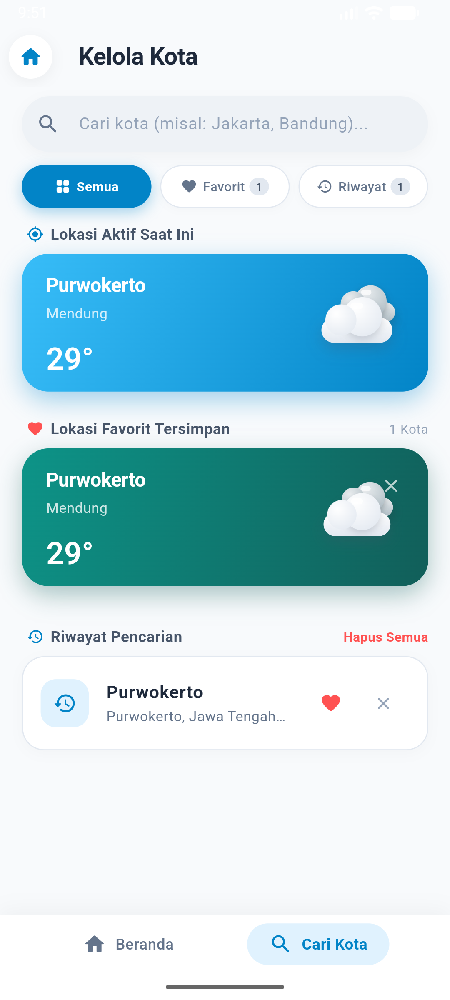
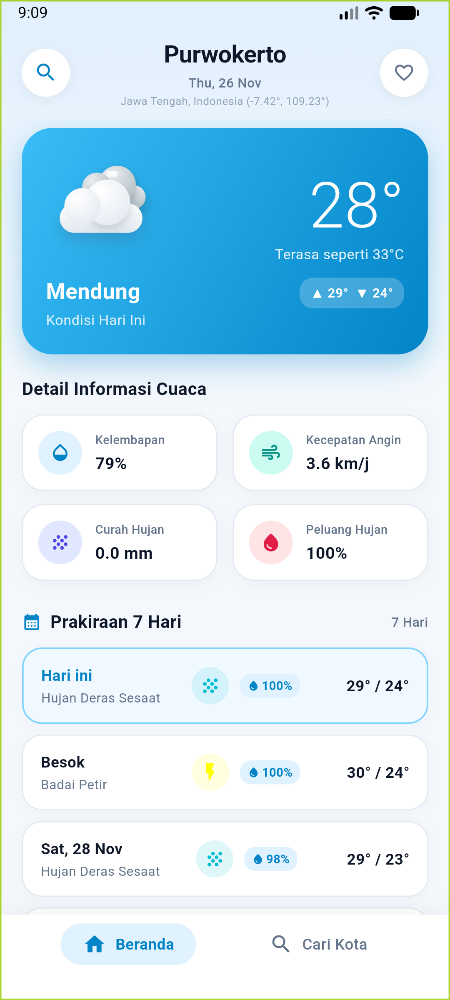
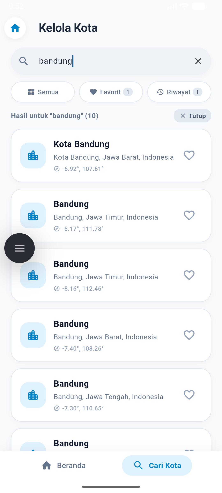
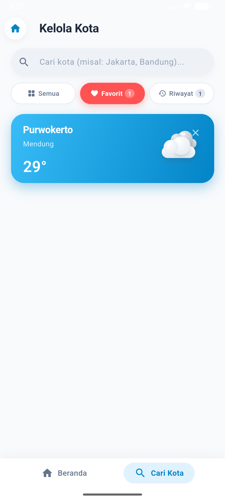

# Responsi Praktikum Pemrograman Mobile - Weather Forecast App

Aplikasi pemantau informasi dan prakiraan cuaca berbasis Flutter dengan arsitektur Model-View-ViewModel (MVVM), integrasi REST API Open-Meteo, dan penyimpanan lokal menggunakan SharedPreferences.

---

## Identitas Praktikan
- **Nama:** Hana Naila Rahmadina
- **NIM:** H1D024093
- **Shift KRS:** Shift D
- **Shift Sekarang:** Shift I

---

## Screenshot Aplikasi

<table>
  <thead>
    <tr>
      <th align="center" width="25%">Halaman Beranda</th>
      <th align="center" width="25%">Halaman Detail Cuaca</th>
      <th align="center" width="25%">Pencarian Lokasi</th>
      <th align="center" width="25%">Lokasi Favorit</th>
    </tr>
  </thead>
  <tbody>
    <tr>
      <td align="center"></td>
      <td align="center"></td>
      <td align="center"></td>
      <td align="center"></td>
    </tr>
  </tbody>
</table>

---

## Penerapan Arsitektur MVVM

Aplikasi ini menerapkan pola arsitektur Model-View-ViewModel (MVVM) yang memisahkan tanggung jawab antarmuka, logika bisnis, dan sumber data:

```
lib/
├── models/             # Data Layer: representasi struktur data JSON
│   ├── location_model.dart     # Model entitas kota, koordinat, dan wilayah
│   └── weather_model.dart      # Model cuaca terkini dan prakiraan harian
├── services/           # Data Source Layer: komunikasi jaringan dan penyimpanan
│   ├── api_service.dart        # Klien HTTP GET ke Open-Meteo API
│   └── storage_service.dart    # Penyimpanan lokal SharedPreferences
├── viewmodels/         # State Management Layer: pengelolaan logika bisnis
│   ├── weather_viewmodel.dart  # State cuaca aktif, favorit, dan riwayat
│   └── search_viewmodel.dart   # State pencarian lokasi secara real-time
└── views/              # Presentation Layer: antarmuka pengguna
    ├── home_screen.dart        # Screen utama cuaca dan prakiraan 7 hari
    ├── search_screen.dart      # Screen pencarian kota, favorit, dan riwayat
    └── widgets/                # Widget modular pendukung antarmuka
```

1. **Model**: Mengolah dan memetakan respons JSON dari API ke dalam objek data Dart (`LocationModel` dan `WeatherModel`).
2. **View**: Dibangun menggunakan Material Design yang menampilkan data dari ViewModel serta merespons interaksi pengguna (`HomeScreen` dan `SearchScreen`).
3. **ViewModel**: Menggunakan `ChangeNotifier` bersama pustaka `Provider` untuk mengelola state data cuaca, alur pencarian kota, status favorit, serta menangani kondisi loading dan error.
4. **Service**: Menangani permintaan HTTP GET ke REST API Open-Meteo (`ApiService`) dan operasi baca/tulis persisten ke SharedPreferences (`StorageService`).

---

## Implementasi Open-Meteo REST API

Aplikasi menggunakan dua endpoint resmi Open-Meteo:
1. **Geocoding API**: `https://geocoding-api.open-meteo.com/v1/search` untuk mencari kota berdasarkan nama serta mendapatkan koordinat latitude dan longitude.
2. **Weather Forecast API**: `https://api.open-meteo.com/v1/forecast` untuk mengambil data cuaca terkini dan prakiraan harian berdasarkan koordinat.

### Pemetaan Field Data yang Ditampilkan

| Data | Field API Open-Meteo | Keterangan |
| :--- | :--- | :--- |
| Suhu saat ini | current.temperature_2m | Ditampilkan dalam satuan derajat Celsius |
| Kelembapan | current.relative_humidity_2m | Ditampilkan dalam persentase |
| Suhu yang dirasakan | current.apparent_temperature | Nilai apparent temperature |
| Curah hujan | current.precipitation | Ditampilkan dalam satuan milimeter |
| Kode kondisi cuaca | current.weather_code | Dikonversi ke deskripsi kondisi cuaca |
| Kecepatan angin | current.wind_speed_10m | Ditampilkan dalam satuan km/jam |
| Suhu maksimum harian | daily.temperature_2m_max | Suhu tertinggi harian |
| Suhu minimum harian | daily.temperature_2m_min | Suhu terendah harian |
| Peluang hujan maksimum | daily.precipitation_probability_max | Peluang hujan tertinggi harian |

---

## Fitur Aplikasi

1. **Home / Weather Screen**: Menampilkan nama kota aktif, kondisi cuaca, suhu saat ini, kelembapan, kecepatan angin, curah hujan, peluang hujan, dan prakiraan cuaca 7 hari ke depan.
2. **Search / Location Screen**: Menyediakan input pencarian kota, menampilkan hasil pencarian dari Geocoding API, memilih kota untuk melihat cuaca, serta menyimpan kota ke dalam daftar favorit.
3. **Local Storage**: Menyimpan daftar kota favorit dan riwayat pencarian menggunakan SharedPreferences sehingga data tetap tersimpan saat aplikasi dibuka kembali.
4. **Error & Loading Handling**: Menangani indikator loading saat mengambil data dari API serta menampilkan pesan error saat koneksi internet terputus.
